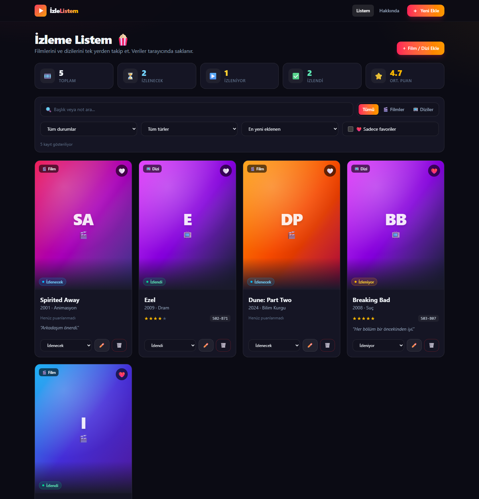
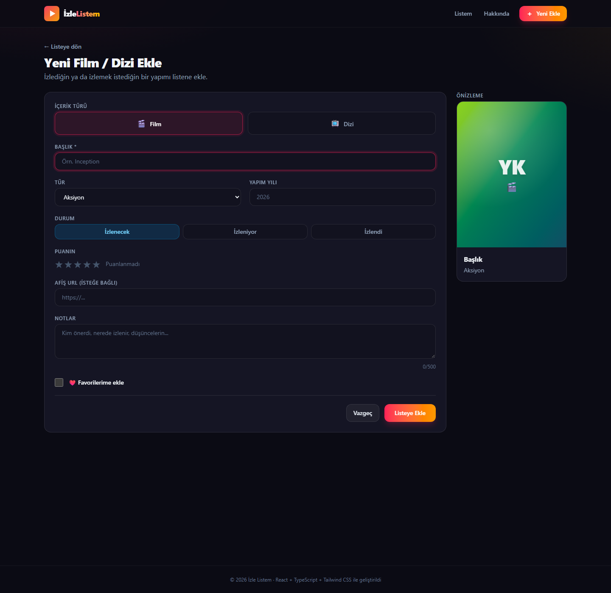
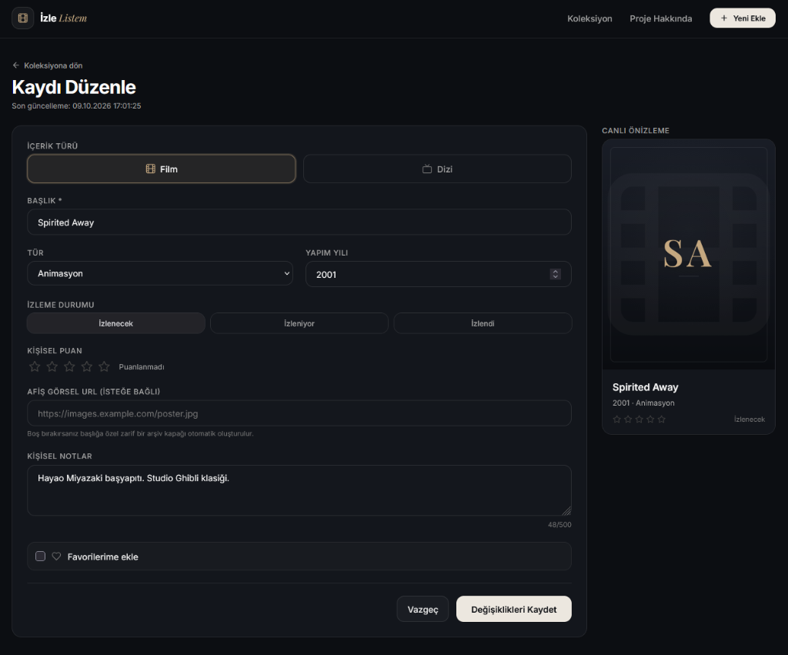

# 🎬 İzle Listem — Film & Dizi Koleksiyonu

Kişisel film ve dizilerinizi takip etmenizi, puanlamanızı ve yönetmenizi sağlayan; **React 19, TypeScript ve Tailwind CSS** ile geliştirilmiş modern bir frontend CRUD web uygulamasıdır. 
Tüm veriler tarayıcının **LocalStorage** alanında saklanır, sayfa yenilense bile korunur. İsteğe bağlı olarak tek tıkla **JSON formatında yedek alabilir** veya **yedeği geri yükleyebilirsiniz**.

> **Web Geliştirme – JavaScript Proje Yönergesi** gereksinimlerine eksiksiz uygun olarak hazırlanmıştır. Neon renklerden uzak, sade, tipografik ve zarif (editorial) bir tasarım dili benimsenmiştir.

---

## 📸 Ekran Görüntüleri

| Ana Sayfa & Koleksiyon Listesi | Yeni Kayıt Ekleme Sayfası |
| :---: | :---: |
|  |  |

| Kayıt Düzenleme Sayfası |
| :---: |
|  |

---

## 📋 Proje Yönergesi Uyumluluk Tablosu

| Yönerge Maddesi | Durum | Projedeki Karşılığı |
| :--- | :---: | :--- |
| **Modern JS Kütüphanesi / Çerçevesi** | ✅ | **React 19** + **TypeScript** + **Vite** kullanıldı. |
| **LocalStorage Kullanımı** | ✅ | Tüm kayıtlar `izle-listem:items` anahtarıyla LocalStorage üzerinde kalıcı olarak tutulur. |
| **Klasör Ağacı Yapısı** | ✅ | `src/components`, `src/pages`, `src/interfaces` klasörleri açıldı ve modüler yapı kuruldu. |
| **CSS Kütüphanesi & Tasarım** | ✅ | **Tailwind CSS v4** ile sade, göz yormayan, zarif ve koyu tonlu minimalist bir arayüz tasarlandı. |
| **Ekle İşlemi** | ✅ | Form doğrulamalı, afiş URL'li, puanlamalı ve canlı önizlemeli ekleme sayfası (`/ekle`). |
| **Listeleme İşlemi** | ✅ | Arama motoru, Film/Dizi sekmeleri, durum & tür filtreleri, 5 farklı sıralama ve istatistik paneli. |
| **Güncelleme İşlemi** | ✅ | Düzenleme sayfası (`/duzenle/:id`), kart üzerinden anlık durum seçimi ve favori işaretleme. |
| **Silme İşlemi** | ✅ | İstenmeyen veri kayıplarını engelleyen `ConfirmDialog` onay modalı ile güvenli silme. |
| **Ekran Görüntüleri** | ✅ | `docs/` klasörüne eklenmiş ve README içerisinde sunulmuştur. |
| **Yayına Alma (Netlify)** | ✅ | `netlify.toml` ve `public/_redirects` ile tek tıkla dağıtıma hazır. |

---

## ✨ Öne Çıkan Özellikler

1. **Zarif & Minimal Tasarım (No-Neon):** Parlak neon renkler ve göz yoran parlamalar yerine, derin grafit zemin (`#0C0E12`), şampanya altın dokunuşları (`#C5A880`) ve fildişi tonlarında dengeli butonlar kullanıldı.
2. **Kriter Edisyonu Afiş Sistemi:** Kullanıcı bir afiş URL'i girmediğinde veya görsel yüklenemediğinde, başlığa özel zarif bir sinema arşiv kapağı SVG/CSS ile dinamik üretilir.
3. **Detay İnceleme Modalı:** Kartlara tıklandığında açılan modal ile yapımın tüm detayları, kişisel notlar, eklenme tarihi, IMDb ve Google arama bağlantıları görüntülenir.
4. **JSON Yedekleme & Geri Yükleme:** "Proje Hakkında" sayfasından tek tıkla koleksiyon `.json` dosyası olarak indirilebilir veya var olan bir yedek yüklenebilir.
5. **Erişilebilirlik & Klavye Desteği:** Modal pencereler `Escape` tuşuyla kapanır, ARIA rolleri ve semantik HTML yapısı tamdır.

---

## 🛠️ Kullanılan Teknolojiler

- **Kütüphane:** [React 19](https://react.dev/) + [TypeScript](https://www.typescriptlang.org/)
- **Derleyici / Build Tool:** [Vite](https://vite.dev/)
- **Stil & Arayüz:** [Tailwind CSS v4](https://tailwindcss.com/)
- **Yönlendirme:** [React Router 8](https://reactrouter.com/)
- **Veri Saklama:** HTML5 Web Storage API (`localStorage`) + JSON File API
- **İkon Seti:** Özel SVG Vektör İkonları (`src/components/icons.tsx`)
- **Yayınlama:** [Netlify](https://www.netlify.com/)

---

## 📁 Proje Dosya Ağacı

```
izle-listem/
├── public/
│   ├── _redirects            # Netlify SPA yönlendirme kuralı
│   └── favicon.svg           # Özel minimalist sinema logosu
├── src/
│   ├── components/           # Yeniden kullanılabilir arayüz bileşenleri
│   │   ├── ConfirmDialog.tsx # Silme onay modalı
│   │   ├── EmptyState.tsx    # Boş durum görünümü
│   │   ├── FilterBar.tsx     # Arama, filtreleme ve sıralama çubuğu
│   │   ├── Header.tsx        # Gezinme çubuğu ve logo
│   │   ├── icons.tsx         # SVG vektör ikon koleksiyonu
│   │   ├── ItemDetailModal.tsx # Film/dizi detay inceleme modalı
│   │   ├── Layout.tsx        # Ortak sayfa iskeleti ve footer
│   │   ├── PageHeading.tsx   # Sayfa başlıkları ve geri bağlantısı
│   │   ├── Poster.tsx        # Akıllı afiş ve edisyon kapağı
│   │   ├── StarRating.tsx    # 5 yıldızlı puanlama bileşeni
│   │   ├── StatsBar.tsx      # İstatistik özet paneli
│   │   ├── StatusBadge.tsx   # Durum rozetleri (İzlenecek, İzleniyor, İzlendi)
│   │   ├── ToastContainer.tsx# Bildirim pencereleri
│   │   ├── WatchItemCard.tsx # Koleksiyon kartı
│   │   └── WatchItemForm.tsx # Ortak ekleme ve düzenleme formu
│   ├── pages/                # Sayfalar
│   │   ├── AboutPage.tsx     # Proje yönergesi, JSON yedekleme ve sıfırlama
│   │   ├── AddItemPage.tsx   # Yeni kayıt ekleme sayfası
│   │   ├── EditItemPage.tsx  # Kayıt düzenleme sayfası
│   │   ├── HomePage.tsx      # Ana sayfa (Listeleme & yönetim)
│   │   └── NotFoundPage.tsx  # 404 sayfası
│   ├── interfaces/           # TypeScript arayüz ve tipleri
│   │   └── WatchItem.ts      # Veri modeli ve filtre tipleri
│   ├── context/              # Context API ile state yönetimi
│   │   ├── ToastContext.tsx  # Bildirim servisi
│   │   └── WatchlistContext.tsx # CRUD işlemleri ve LocalStorage senkronu
│   ├── utils/                # Yardımcı fonksiyonlar ve sabitler
│   │   ├── constants.ts      # Türler, durumlar ve sıralama seçenekleri
│   │   ├── sampleData.ts     # Varsayılan sinema koleksiyonu verileri
│   │   └── storage.ts        # LocalStorage okuma/yazma yardımcıları
│   ├── App.tsx               # Rota yapılandırması
│   ├── index.css             # Tailwind v4 tema ve yardımcı sınıflar
│   └── main.tsx              # React başlangıç noktası
├── docs/                     # Proje ekran görüntüleri
├── netlify.toml              # Netlify dağıtım ayarları
├── package.json
└── README.md
```

---

## 🚀 Kurulum ve Yerel Çalıştırma

### Gereksinimler
- [Node.js](https://nodejs.org/) (v18 veya üzeri önerilir)
- npm veya yarn

### Adımlar

1. **Depoyu klonlayın:**
   ```bash
   git clone https://github.com/sefakesen/izle-listem.git
   cd izle-listem
   ```

2. **Bağımlılıkları yükleyin:**
   ```bash
   npm install
   ```

3. **Geliştirme sunucusunu başlatın:**
   ```bash
   npm run dev
   ```
   Tarayıcınızda `http://localhost:5173` adresine giderek uygulamayı görüntüleyebilirsiniz.

4. **Üretim için derleme (Production Build):**
   ```bash
   npm run build
   ```
   Oluşan `dist/` klasörü doğrudan Netlify veya Vercel üzerine yüklenebilir.

---

## 🌐 Netlify Üzerinde Yayına Alma (Deploy)

1. Projeyi GitHub hesabınıza `public` olarak yükleyin.
2. [Netlify](https://app.netlify.com/)'e giriş yapıp **"Add new site" -> "Import an existing project"** seçin.
3. GitHub deponuzu (`izle-listem`) seçin.
4. Derleme ayarlarını kontrol edin:
   - **Build command:** `npm run build`
   - **Publish directory:** `dist`
5. **Deploy Site** butonuna tıklayın. Sayfa anında canlıya alınacaktır.
